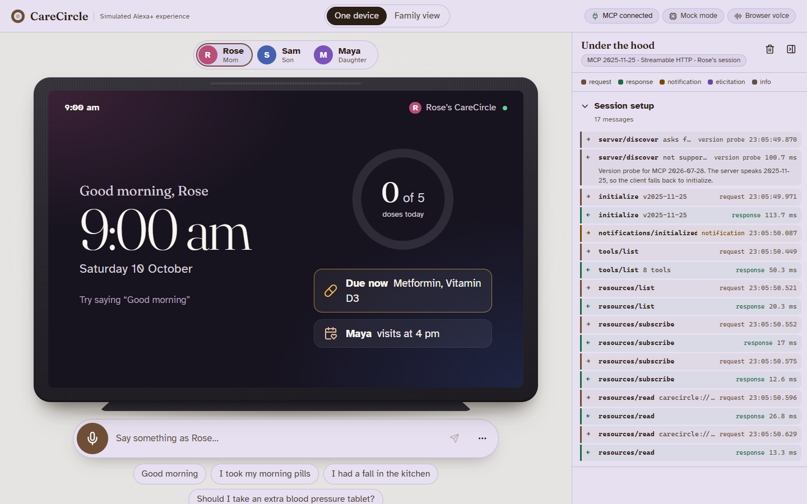
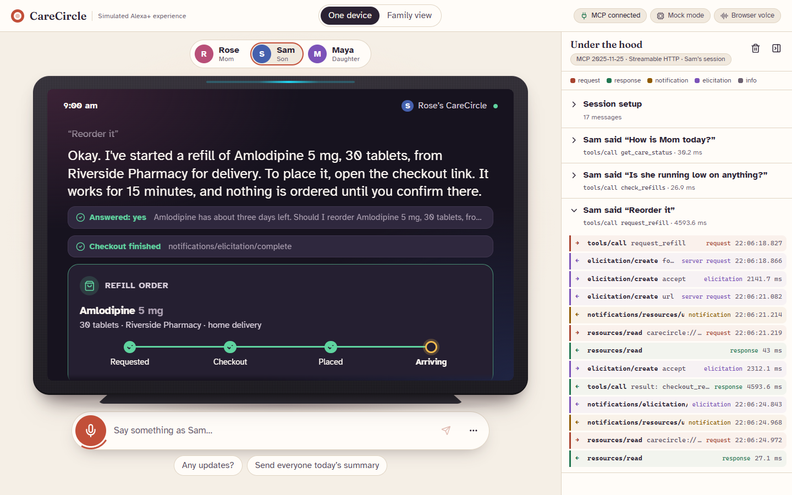
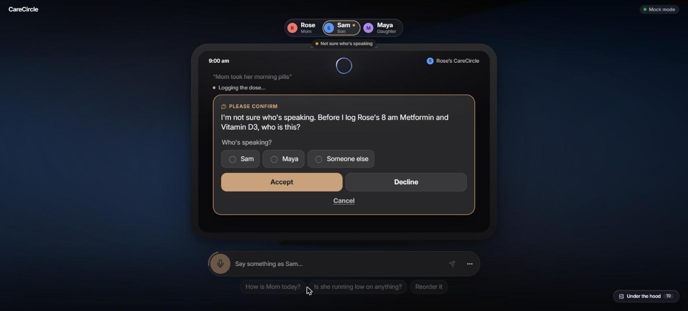
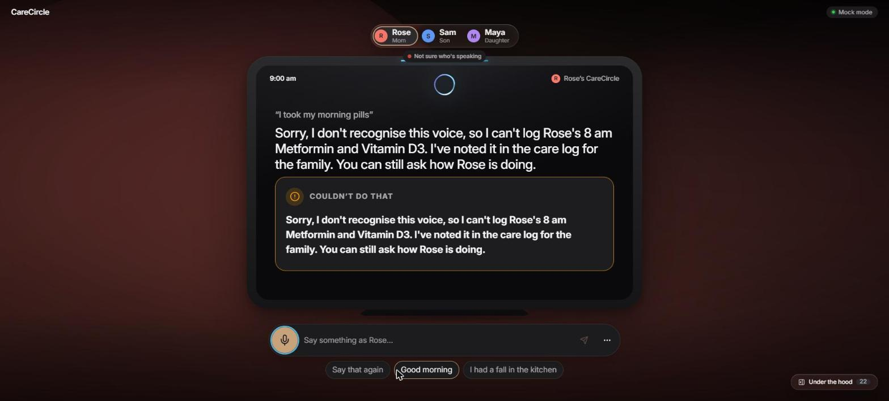
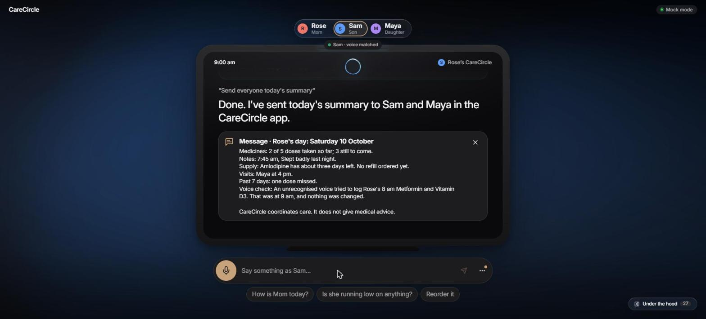
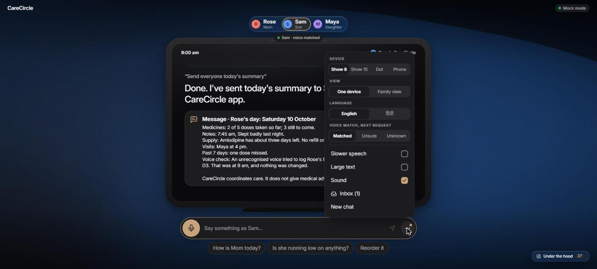

# CareCircle

**A family care coordinator for Alexa+.** CareCircle lets an older parent log medicines and how they feel by voice, and gives the rest of the family a one-sentence answer to "How is Mom today?".

Built for the [Build, Ship, Shape: Amazon Developer Hackathon](https://amazonappdev2026.devpost.com/): **Alexa+ track** (self-hosted MCP server, spec 2025-11-25, Streamable HTTP) and the **AWS Builder** mini challenge.

> CareCircle coordinates care. It never gives medical advice, changes doses or diagnoses. All data in this repo is synthetic.

## Status

| Part | State |
| --- | --- |
| MCP server (`server/`): 8 tools, 4 resource templates (2 subscribable), 1 MCP App view, 2 prompts, stateful Streamable HTTP | Working, 70 tests |
| Refill ordering: voice confirmation, form and URL elicitation, secure checkout page | Working |
| Simulator (`alexa-sim/`): Strands agent on Amazon Bedrock (Nova 2 Lite), Amazon Polly, device frames, live MCP protocol panel | Working, mock and AWS modes |
| Interactive care dashboard (MCP Apps) | Working |
| Family features: live updates across devices, safety alerts, Hindi, accessibility, gentle reminders, evening summary (Amazon SNS) | Working |
| Appointment coordination (Tasks), Strands care team, care preferences | Working |
| Who's speaking? Identity-aware safety on shared devices (simulated voice match, rules enforced by the server) | Working |
| AWS deployment: AgentCore Runtime, Strands care-team agents | Next |

## Quick start (no AWS needed)

Requires Node.js 20 or later.

```bash
cd server
npm install
npm run dev
```

The server listens on `http://127.0.0.1:8000/mcp`.

**Try it with MCP Inspector:**

```bash
npx @modelcontextprotocol/inspector
```

Open the URL it prints, choose **Streamable HTTP**, enter `http://127.0.0.1:8000/mcp` and click **Connect**. Under **Tools**, run `get_care_status`.

**Switch family member** by adding a header in Inspector's Authentication section: `Authorization: Bearer dev:rose` (or `dev:sam`, `dev:maya`). With no header you are Sam.

**Freeze the clock** for a repeatable demo, e.g. 9 am in India:

```bash
CARECIRCLE_NOW=2026-10-10T03:30:00Z npm run dev          # macOS / Linux
$env:CARECIRCLE_NOW="2026-10-10T03:30:00Z"; npm run dev  # Windows PowerShell
```

**Run the tests:**

```bash
npm test
```

## Run the simulator

The real Alexa+ add-on tools are partner-only ([friction log FL-01](docs/friction-log.md)), so CareCircle ships its own simulator that plays the Alexa+ role. It listens, reasons with a Strands agent on Amazon Bedrock, calls the CareCircle server as a standard MCP client, speaks with Amazon Polly, and shows cards. A live protocol panel shows every JSON-RPC message.





```text
browser (React, :5173) ──/api──▶ orchestrator (FastAPI + Strands, :8100) ──MCP Streamable HTTP──▶ CareCircle server (:8000)
                                     │ Bedrock Converse (Nova 2 Lite)
                                     │ Polly SynthesizeSpeech (neural)
```

### Prerequisites

- Node.js 20 or later
- Python 3.11 or later. [uv](https://docs.astral.sh/uv/) is used if installed; otherwise `python -m venv`.
- Chrome or Edge for push-to-talk. The text box works in any browser.
- For AWS mode only: AWS credentials in the default chain (`aws configure`) with access to Bedrock and Polly.

### Setup and start (Windows PowerShell, macOS, Linux)

```bash
npm run setup       # server + web dependencies, and the orchestrator's Python env
npm run sim:demo    # MCP server :8000, orchestrator :8100, web :5173, clock frozen at 9 am IST
```

Open http://127.0.0.1:5173. Ctrl+C stops all three processes.

| Command | Brain | Voice | Clock |
| --- | --- | --- | --- |
| `npm run sim:mock` | Mock keyword router, no AWS calls | Browser speech | Frozen at 9 am IST |
| `npm run sim:demo` | Bedrock if AWS credentials are found, else mock | Polly if it works, else browser | Frozen at 9 am IST |
| `npm run sim` | Same as `sim:demo` | Same as `sim:demo` | Real time |

If uv or npm isn't wanted, the Python env can be made by hand:

```bash
cd alexa-sim/orchestrator
python -m venv .venv                      # Windows: py -3.12 -m venv .venv
.venv/bin/pip install -e ".[dev]"         # Windows: .venv\Scripts\pip install -e ".[dev]"
# or: uv venv --python 3.12 && uv pip install -e ".[dev]"
```

### Mock mode (no AWS account)

With `MOCK_AWS=1`, or when no AWS credentials are found, a small deterministic keyword router picks the tool instead of Bedrock, and the browser speaks instead of Polly. Everything else stays real: the MCP server, elicitation and the protocol log. Judges can run the whole demo without an AWS account.

### AWS mode

The orchestrator uses only the default AWS credential chain; never put keys in files. Settings live in `alexa-sim/orchestrator/.env` (copy `.env.example`):

| Variable | Default | Meaning |
| --- | --- | --- |
| `BEDROCK_MODEL_ID` | `global.amazon.nova-2-lite-v1:0` | Model for the Strands agent (Converse API) |
| `AWS_REGION` | `ap-southeast-2` | Bedrock and Polly Region |
| `POLLY_VOICES` | `Kajal,Joanna` | Neural voices to try at startup, in order |
| `MOCK_AWS` | auto | `1` forces mock mode, `0` forces AWS mode |
| `MCP_URL` | `http://127.0.0.1:8000/mcp` | CareCircle server |
| `REMINDER_IDLE_S` | `45` | Seconds a device must be quiet before it gives a gentle dose reminder; `0` turns reminders off |

If a Bedrock call fails mid-demo (throttling, network, access), that turn falls back to the mock router and the simulator shows a warning banner: "AWS Bedrock failed, so this turn used the offline router." If Polly fails, the browser speaks instead. `GET http://127.0.0.1:8100/healthz` reports which modes are active.

### Demo script

With the clock frozen at 9 am IST (`npm run sim:demo` or `sim:mock`):

1. **Rose:** "Good morning". She hears her doses due, Maya's 4 pm visit and the low Amlodipine.
2. **Rose:** "I took my morning pills". Metformin and Vitamin D3 are logged once.
3. **Sam:** "How is Mom today?" Two of five doses taken, the next dose, the visit and the note.
4. **Sam:** "Is she running low on anything?" then "Reorder it", then accept the form, then **Open secure page** and **Place order**. The card turns green when the server sends `notifications/elicitation/complete`.
5. Switch to **Dot**. **Sam:** "Any updates?" The reply now ends "A refill arrives tomorrow."
6. **Sam:** "Book Mom's cardiology follow-up next week, mornings only, and sort out a ride." A picker offers three times, best first ("Tue 10:30 am with Dr Rao, Maya drives"). Pick one: "Booked: Rose's cardiology follow-up with Dr Rao at Riverside Heart Clinic, Tuesday at 10:30 am. Maya is driving, leaving at 10:05 am." Decline instead, and nothing is booked.
7. **Rose:** "I had a fall in the kitchen". She gets safety advice and a red alert card, and the family is flagged.
8. **Rose:** "Should I take an extra blood pressure tablet?" She gets a safe refusal, and no tool is called.

**New chat** resets a profile's MCP session and conversation. Restart `npm run sim:demo` to reset the family's data.

### Family demo (two devices)

Click **Family view** at the top: Rose on a Show 8 on the left, Sam on a Phone on the right. Each has its own input, settings and conversation.

1. **Rose:** "Good morning". **Sam:** "How is Mom today?" Both get the dashboard.
2. On Rose's dashboard, tap **Mark taken** on Metformin. Sam's dashboard updates by itself (the protocol panel shows `notifications/resources/updated`, then `resources/read`).
3. On Rose's device, click **Remind now** (or wait 45 seconds without speaking). "Rose, a gentle reminder: your Vitamin D3 from 8 am isn't logged yet. Have you taken it?" **Rose:** "Yes". It's logged.
4. **Rose:** "I had a fall in the kitchen". Sam's phone lights up yellow and announces the alert. Rose's own device doesn't.
5. **Rose:** "Say that again". The last reply again, slower, with no tool call.
6. Switch Rose to **हिंदी** (or say "Talk to me in Hindi"). **Rose:** "सुप्रभात". She hears her status in Hindi and her dashboard is in Hindi; Sam still hears English.
7. **Sam:** "Send everyone today's summary". The summary arrives as a message on Sam's phone (and Maya's), and by email when SNS is set up.

## Agent Skill

[`skills/carecircle/SKILL.md`](skills/carecircle/SKILL.md) is an [Agent Skill](https://agentskills.io/). It teaches any agent to use this server: how to connect, which tool fits each request, the safety rules and two worked examples. [`skills/carecircle/README.md`](skills/carecircle/README.md) explains how to install it in Claude Code or Kiro.

## What the server exposes

### Tools

| Tool | Say something like | Notes |
| --- | --- | --- |
| `get_care_status` | "How is Mom today?", "Good morning" | Read-only. Doses taken, due and missed, next dose, visits, latest wellbeing note, low supplies |
| `list_medications` | "What do I take tonight?" | Read-only. Optional `when`: morning, noon, evening, night |
| `log_medication` | "I took my morning pills", "I took the blood pressure one" | Idempotent: repeating a call never double-logs. Ambiguous names return options to ask about |
| `check_refills` | "Am I running low on anything?" | Read-only. Days of supply left, when each runs out, and any refill already on its way |
| `request_refill` | "Reorder my blood pressure tablets", "Yes" after a low-supply warning | Asks first, then opens a one-time checkout link. Nothing is ordered until checkout is completed. Asking twice never orders twice |
| `coordinate_appointment` | "Book Mom's cardiology follow-up next week, mornings only, and sort out a ride" | Checks the clinic, family calendars and travel time, offers up to three ranked options, and books only the one the person picks. Can run as an MCP Task |
| `set_care_preference` | "Mom prefers mornings", "Not on Fridays" | Remembers appointment times of day and days for the whole family, across conversations. `coordinate_appointment` uses them unless a request says otherwise |
| `log_wellbeing` | "I slept badly", "I had a fall", "मैं रसोई में गिर गई" | Red-flag words (falls, chest pain, breathing trouble, in English or Hindi) return safety guidance and alert the family's devices |
| `set_language` | "Talk to me in Hindi", "हिंदी में बात करो", "Speak English" | Changes only the caller's own language; the rest of the family keeps theirs |
| `get_morning_rhythm` | "Has Mom been up this morning?", "How have her mornings been?" | Read-only. When she was first active today against her usual time, and any late or quiet mornings this week |
| `set_check_ins` | "Mom's staying with me till Sunday", "Turn off the check-ins" | Pause (resumes by itself, at most 30 days), resume, turn on, or turn off (only after a clear yes). Anyone in the family can, including Rose |
| `send_daily_summary` | "Send everyone today's summary" | Writes the day's summary to the family inbox, and to Amazon SNS when configured. Also sent automatically every evening |

Every tool returns three things:

- `structuredContent`, matching the tool's declared `outputSchema`, for reasoning and on-screen cards.
- A short spoken sentence in `content`, written for screenless Echo devices: no Markdown, tables or URLs.
- Annotations (`readOnlyHint`, `idempotentHint`, `destructiveHint`, `openWorldHint`).

### Refill ordering

The order needs two separate yeses: a spoken one, then one on a checkout page.

1. **"Reorder?"** `request_refill` never orders without asking. If the client supports form elicitation, it always asks there (reorder yes/no, delivery or pickup), even if the model already sent `confirm: true`, so the yes comes from the person and not the model. Otherwise it returns `needs_confirmation` with a question for Alexa to speak ("Amlodipine has about three days left. Should I reorder Amlodipine 5 mg, 30 tablets, from Riverside Pharmacy for delivery?"). Alexa calls it again with `confirm: true` only after a clear yes.
2. **Checkout link.** The order is created as `awaiting_checkout` with a one-time link at `/checkout/<token>`. If the client supports URL-mode elicitation, the link goes straight to the browser, so it never passes through the model. It also always appears in `structuredContent.checkoutUrl` for an on-screen card. It is never spoken.
3. **Secure checkout page.** The page shows the medicine, quantity, pharmacy and delivery or pickup, with **Place order** and **Cancel** buttons. When it is completed, a `notifications/elicitation/complete` goes back to the session that asked. From then on, `get_care_status` and `check_refills` say "A refill arrives tomorrow."

How the checkout is secured:

- Tokens are 256 random bits, single-use and valid for 15 minutes. Only a SHA-256 hash is stored.
- Placing an order is a compare-and-set from `awaiting_checkout`. A double submit, or a submit racing a cancel, places at most one order.
- Form posts must come from the page's own origin (`403` otherwise), on top of the app-wide Host and Origin checks.
- Responses are sent with `Cache-Control: no-store`, `Referrer-Policy: same-origin`, `X-Frame-Options: DENY` and a CSP that allows no scripts.
- No card or payment details are ever collected: payment is settled with the pharmacy. In this demo no real order leaves the server.
- Only the recipient and coordinators can start a refill; helpers get a spoken refusal.

### Appointments and rides

`coordinate_appointment` plans a doctor's visit and a ride, then books only what the person picks.

1. **Plan.** It checks the clinic's open slots, who in the family is free to drive (for the whole round trip) and the travel time, and ranks up to three options with a one-line reason each. A family member driving beats a taxi, then earliest first. Clinic, calendars and travel are synthetic services behind small interfaces (`server/src/domain/appointments.ts`), so a real booking API or calendar can replace them.
2. **Pick.** Clients with form elicitation get a slot picker. Declining books nothing. As with refills, `confirm: true` from the model never skips the picker. Voice-only clients get `needs_choice` with the options read aloud. To book, they call again with `option_id` and `confirm: true` after a clear yes. The server only accepts an option it read out to that family in the last 30 minutes.
3. **Book.** The appointment shows in `get_care_status` ("Cardiology follow-up with Dr Rao on Tuesday at 10:30 am. Maya is driving.") and on family screens. The driver also gets a helper task, for example "Drive Rose to Riverside Heart Clinic" at 10:05 am. Booking the same slot twice never doubles up.

**Who ranks the options: a Strands care team.** In the simulator, the server asks the orchestrator's care team, a Strands Agents multi-agent Graph:

```text
coordinator --+--> clinic ------+
              +--> calendar ----+--> planner
              +--> transport ---+
```

- The **coordinator** restates the request and preferences.
- **Clinic**, **family calendar** and **transport** run in parallel. Each reads its part of the facts through a tool.
- The **planner** picks up to three options with a one-line reason each.
- The server sends the facts as a brief to `POST /plan/appointment`. It keeps the task, the picker and the booking itself.

The two modes:

- **AWS mode:** each node is an Agent on Amazon Bedrock (`global.amazon.nova-2-lite-v1:0` in `ap-southeast-2`). One plan took about 9 seconds in testing, with the three specialists overlapping.
- **Mock mode,** and the fallback when Bedrock fails: the same Graph runs with deterministic nodes, so the same request always gets the same three options and judges can run it without AWS.

The server re-checks every pick. It must be a real open slot that fits the constraints, with a driver who is actually free. Anything else is dropped and topped up from the server's own ranking. If the care team is unreachable, the server ranks locally. `structuredContent.plannedBy` shows which one ranked the options, for example `strands-graph:bedrock:global.amazon.nova-2-lite-v1:0`, `strands-graph:deterministic` or `local`.

**MCP Tasks (2025-11-25, experimental).** The tool is listed with `execution.taskSupport: "optional"`, and the server advertises `capabilities.tasks`.

- A `tools/call` with a `task` param returns a task handle at once.
- The status moves `working` ("Checking the clinic…", "Checking who can drive…") to `input_required` (pick a slot) to `completed`. Each change is sent as `notifications/tasks/status`.
- The picker is asked as an elicitation on the client's `tasks/result` request, tagged with the related task.
- `tasks/get`, `tasks/result`, `tasks/list` and `tasks/cancel` are supported. Cancelling while it waits for a pick books nothing.
- Tasks belong to the member who started them.
- Without a `task` param, the tool runs synchronously and sends `notifications/progress` with the same steps.

**Preferences.** When someone says "Mom prefers mornings" or "not on Fridays", `set_care_preference` stores it on the family. It's kept server-side, so it applies to any family member's next conversation. The next booking uses it when the request doesn't say otherwise, and says so: "…mornings, as Rose prefers". Whatever is asked this time wins. "Forget Mom's appointment preferences" clears them. Here they live in the server's store. In production, AgentCore Memory is the natural home for them (long-term memory per family), behind the same store interface. That isn't deployed in this project.

The MCP TypeScript SDK 2.3.1 has the task wire types but no task runtime, so `server/src/mcp/tasks.ts` provides one (see the friction log).

### Who's speaking? (shared devices)

An Echo in Rose's kitchen is shared. Rose, Sam, Maya and visitors all talk to it, so CareCircle checks who is speaking before it changes anything.

**The voice match is simulated.** This project has no voice recognition. Each request carries a pretend match, which the simulator sets from its … menu: *Matched*, *Unsure* or *Unknown*. Alexa+ doesn't currently pass a speaker match to MCP servers (see the friction log). **The server enforces the rules**, in front of every tool call (`server/src/mcp/identity.ts`). The model can't skip them, and a prompt can't talk its way past them.

- **How it's sent (dev auth):** next to `Authorization: Bearer dev:<user>`, send `X-Speaker-Confidence: high | low | unknown`. With `low`, also send `X-Speaker-Candidates: sam,maya`, the household members the match was unsure between. No header means `high`, so existing clients keep working.
- **Read and change tools:**
  - Reads: `get_care_status`, `list_medications` and `check_refills`.
  - Changes: `log_medication`, `log_wellbeing`, `request_refill`, `coordinate_appointment`, `set_language`, `set_care_preference` and `send_daily_summary`.
  - A tool missing from the list counts as a change, and a test fails until it's classified.

| Confidence | Read tools | Change tools |
| --- | --- | --- |
| High | Work | Work as usual |
| Low | Work | Nothing changes until the person says who they are. Clients with forms get "Who's speaking?", offering only the candidates and *Someone else*. Clients without forms get a phone confirmation through URL elicitation: a one-time "Was this you?" page at `/voice-check/<token>`. The change then runs as the person who confirmed, with that person's role |
| Unknown | Work | Refused politely ("Sorry, I don't recognise this voice, so I can't log Rose's 8 am Metformin…"), recorded in the care log (the live `today` resource) and listed in the next family summary: "Voice check: An unrecognised voice tried to log Rose's 8 am Metformin. That was at 9 am, and nothing was changed." |

When someone logs a dose for someone else, the log records who did it. Sam logging Rose's Metformin stores `loggedBy: "sam"`, and it shows in `log_medication` and `get_care_status` results. If Maya confirms on Sam's device, the log says Maya.

In the simulator, each device shows a badge such as "Sam · voice matched" or "Not sure who's speaking". The … menu sets the match for the next request only. Mock and Bedrock modes both work unchanged, because the rules live on the server.

| Unsure: who's speaking? | Unknown: refused | In the family summary |
| --- | --- | --- |
|  |  |  |



### Morning check-ins

Families using Alexa for an older parent told Amazon what they wanted: a heads-up when Mom's
usual morning activity is late (Care Hub and Alexa Together's activity alerts), trends and
deviations rather than a raw activity feed (a reviewer's main wish for Alexa Together), and, from one son whose
mother had died, a way to stop the alerts that kept coming. CareCircle does all three, gently:

1. **Learns the usual morning.** From the past two weeks of what Rose did herself (logging a
   dose, a note about how she feels, or just talking to CareCircle), it works out when she is
   usually up and about (8:20 am in the demo data). Someone else logging for her doesn't count.
2. **Asks her first.** If nothing has come from her 30 minutes past that, her own device asks:
   "Good morning, Rose. Just checking in… How are you feeling today?" Anything she says answers it.
3. **Then the family, calmly.** Only if there's still no answer 30 minutes later do Sam and Maya
   hear about it, on their devices and in the inbox (and Amazon SNS when configured), with the
   context and a clear line that CareCircle is not an emergency service. When she answers, they
   get "Good news: Rose answered at 9:30 am."
4. **Trends, not a feed.** `get_morning_rhythm` says how today compares with her usual time and
   calls out late or quiet mornings this week. The evening summary includes the morning.
5. **The family stays in control.** Pause for a stay away or a hospital visit ("till Sunday");
   check-ins resume by themselves the day after, and a pause can't be longer than 30 days.
   Turning them off needs a clear yes, and Rose can do it herself.

The server runs the check-in every minute. In the demo the clock is frozen at 9 am, so the
device menu has **Skip ahead 30 min** and **Skip to the next 8:30 am** (demo only: the server
route exists only when the clock is frozen). Try: Skip to the next 8:30 am, Skip ahead 30 min
(Rose's device checks in), Skip ahead 30 min (Sam and Maya are told), then as Rose, "I'm fine, I
just slept in".

### Resources and prompts

- `carecircle://family/{familyId}/care-plan`: the care plan as Markdown
- `carecircle://family/{familyId}/log/{date}`: one day's doses, notes and visits as JSON
- `carecircle://family/{familyId}/today`: **subscribable.** Today's status for the reader, in their language, plus today's safety alerts and (for the person cared for) a gentle reminder about overdue doses
- `carecircle://family/{familyId}/inbox`: **subscribable.** Messages CareCircle sent the family (the evening summary)
- `ui://carecircle/care-dashboard`: the MCP App view for `get_care_status` (`text/html;profile=mcp-app`, self-contained, no network)
- Prompts: `morning_briefing`, `caregiver_handoff`

Resources are scoped to the caller's own family; any other family id reads as "not found".

### Live family updates

Every write to the store (a dose, a note, an order, a language change, a message) is announced on a family-wide change feed. Each session can `resources/subscribe` to `today` and `inbox`, and gets `notifications/resources/updated` within about 120 ms of a change, one per burst. Rose taps **Mark taken** on her Echo Show; Sam's phone shows it straight away. The server only says what changed; the device decides how to show or announce it.

### Hindi

Each family member has a spoken language (`set_language`). For Hindi, the main replies (status, logging doses, notes, schedules, supplies, reminders and alerts) are written in Hindi on the server, with medicine names kept as on the box. In AWS mode, Nova replies in Hindi and Polly's Kajal voice speaks it (`hi-IN`). In mock mode, the router understands common Hindi and Hinglish phrases ("मैंने दवा ले ली", "maine dawai le li"), and turns symptoms into an English note with her own words kept, so the family can read it. Red-flag words are detected in Hindi too.

### Evening summary

At 8:30 pm family time (`DIGEST_TIME`), CareCircle sends everyone except the person cared for a short written summary: doses taken and missed, alerts, notes, supplies and visits. It always goes to the family inbox. To also send it by email or SMS, create an Amazon SNS topic, subscribe the family to it, and set `SNS_TOPIC_ARN`:

```bash
aws sns create-topic --name carecircle-family-summary --region ap-southeast-2
aws sns subscribe --topic-arn <topic arn> --protocol email --notification-endpoint you@example.com
# confirm the email, then start the server with SNS_TOPIC_ARN=<topic arn>
```

If SNS fails, the message still reaches the inbox and the failure is recorded on it.

### Transport (MCP 2025-11-25 Streamable HTTP)

- One `/mcp` endpoint: `POST` for client messages, `GET` for the server-to-client SSE stream, `DELETE` to end a session.
- Stateful sessions with a random `MCP-Session-Id`, bound to the user who opened them. Unknown sessions get `404`, missing ones `400`, another user's `403`.
- `MCP-Protocol-Version` is checked on every request (`400` if unsupported). Negotiates `2025-11-25`; also accepts `2025-06-18` and `2025-03-26`.
- `Origin` and `Host` validation against DNS rebinding (`403`). Binds to `127.0.0.1` by default.
- SSE events carry ids, and an in-memory event store lets dropped streams resume with `Last-Event-ID`.

## Configuration

| Variable | Default | Meaning |
| --- | --- | --- |
| `PORT` | `8000` | HTTP port (AgentCore Runtime expects 8000) |
| `HOST` | `127.0.0.1` | Bind address. Use `0.0.0.0` in a container, with `ALLOWED_HOSTS` |
| `ALLOWED_HOSTS` | localhost names | Comma-separated Host header allow-list |
| `ALLOWED_ORIGINS` | localhost names | Comma-separated Origin allow-list for browser clients |
| `CARECIRCLE_DEFAULT_USER` | `sam` | Who you are when no `Authorization` header is sent |
| `CARECIRCLE_NOW` | real time | Freeze the clock (ISO 8601) |
| `CARECIRCLE_SEED` | `seed/rose.json` | Seed family file |
| `PUBLIC_URL` | the request's origin | Base URL for checkout links when running behind a proxy or on AWS |
| `DIGEST_TIME` | `20:30` | Family-local time for the evening summary; `off` disables the scheduler |
| `SNS_TOPIC_ARN` | unset | Amazon SNS topic for the evening summary. Unset = in-app inbox only |
| `AWS_REGION` | SDK default | Region for SNS |
| `CARECIRCLE_PLANNER_URL` | unset | The orchestrator's care team endpoint for appointment planning, e.g. `http://127.0.0.1:8100/plan/appointment` (`npm run sim` sets it). Unset = rank locally |

Dev auth (`Bearer dev:<userId>`, plus the simulated `X-Speaker-Confidence` and `X-Speaker-Candidates` headers) is for local use only. The AWS deployment replaces it with Cognito JWTs validated by AgentCore Runtime.

## Repository layout

```text
server/                 MCP server (TypeScript, MCP SDK v2)
  src/domain/           Pure care logic: dose status, refills and refill orders, name matching, safety words
  src/store/            Storage interface, in-memory store, seed loader
  src/mcp/              Tools, resources, prompts, server factory
  src/http/             Streamable HTTP app, dev auth, event store, refill checkout and voice-check pages
  test/                 Unit, MCP and transport conformance tests
seed/rose.json          Synthetic demo family (dates relative to today)
mcp.config.json         Client config pointing at the local server
alexa-sim/orchestrator/ Simulator brain (Python): MCP client, Strands agent on Bedrock, the appointment care team (Strands Graph), Polly, SSE API
alexa-sim/web/          Simulator UI (React + Vite): device frames, cards, elicitation, protocol panel
scripts/                Cross-platform setup and launcher (npm run setup / sim)
skills/carecircle/      Agent Skill: how any agent should use the CareCircle server
docs/friction-log.md    Developer friction log for the hackathon
```

## License

[MIT](LICENSE)
